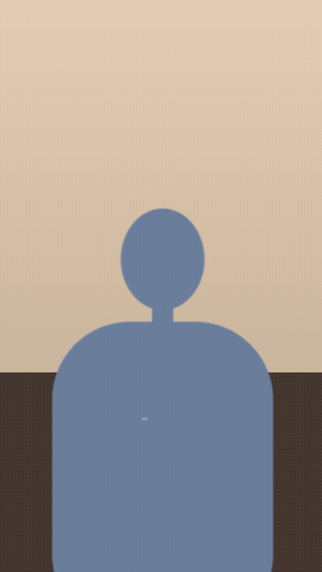
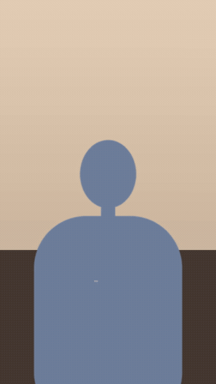
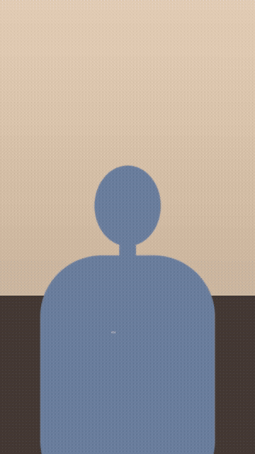
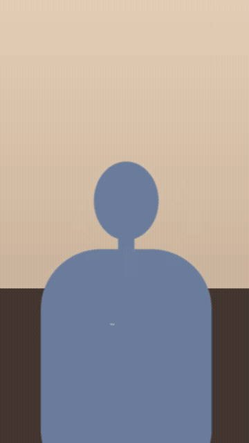
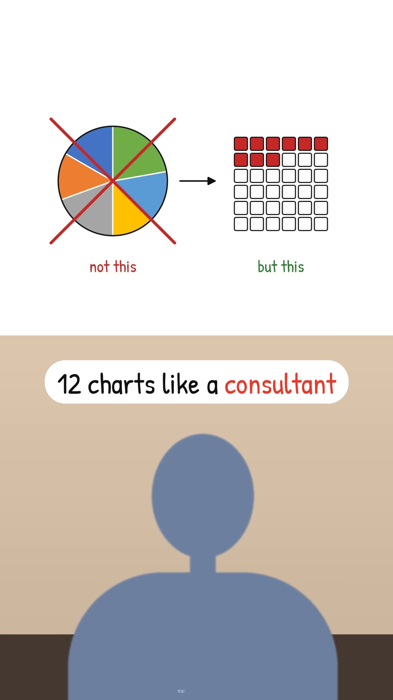

# reelkit

The tools behind the @heytheanalyst reels: transcription, jump cuts, captions, sound effects,
"Not this / But this" chart overlays, the stacked "panel on top" layout, covers, and all the chart
and psychology visuals.

Everything runs locally with Python + ffmpeg. No paid APIs.

## Setup

```bash
pip install -r requirements.txt
# ffmpeg must be installed (brew install ffmpeg / apt install ffmpeg)
# Fonts: Poppins (https://fonts.google.com/specimen/Poppins) and Patrick Hand for the hand-drawn covers
```

Optional, for offline transcription, download into `models/`:
`sherpa-onnx-whisper-base.en/` and `silero_vad.onnx` from the sherpa-onnx releases page.

## Sections

Each section is a folder of interchangeable styles, with a script and a preview (made on a placeholder figure, never real footage).

| Section | Styles | Folder |
|---|---|---|
| Captions | keyword_red, word_pop, karaoke, boxed, handwritten | [`captions/`](captions/) |
| Hooks | hook_caption, headline_box, backdrop_word, red_stamp, typed_question | [`hooks/`](hooks/) |
| Calls to action | end_card, comment_box, follow_button, save_prompt | [`cta/`](cta/) |
| Covers | handdrawn_pareto, handdrawn_pie_waffle, big_text, card_over_face, drawing_plus_face | [`covers/`](covers/) |
| Overlays | orbit | [`overlays/`](overlays/) |
| Coming next | layouts, data visuals, explainers, motion, transitions, looks, sound, carousels | |

<p>
 
 

</p>

All effects share one engine, `reelkit/fx.py`, which stacks: your video → layer behind you → your cut-out → layer in front, then adds quiet sound effects.
Fonts are in `fonts/` (open licences).

## The tools (`reelkit/`)

| Command | What it does |
|---|---|
| `python -m reelkit.transcribe raw.mov -o segs.json` | Timed speech segments (or loud-burst timings without models) |
| `python -m reelkit.cut raw.mov -o edit.mp4 --keep 0.3-2.4 5.6-6.7` | Jump cuts; prints each clip's new start time |
| `python -m reelkit.captions captions.json -o captions.ass --keywords consultant 80%` | Burned-in captions, keywords in red |
| `python -m reelkit.sfx events.json --duration 30 -o sfx.wav` | Quiet pops, whooshes, dings, typing clicks on a timeline |
| `python -m reelkit.stack --panel panel.mp4 --video raw.mov --sfx sfx.wav --captions captions.ass` | Panel (1080×1000) on top, talking head below |
| `python -m reelkit.pairs configs/not_this_but_this.json` | "✗ NOT THIS / ✓ BUT THIS" cards over the full-screen video, hook caption, end card |
| `python -m reelkit.pairs config.json --still 19.2 cover.jpg` | Any frame as a cover image |

### Not this / But this in 3 steps
1. Record yourself saying "not this… but this" once per chart.
2. `python -m reelkit.transcribe raw.mov` and copy the start times into `configs/not_this_but_this.json`.
3. `python -m reelkit.pairs configs/not_this_but_this.json`

Layout keys (`card_w`, `card_h`, `top`, `bottom`) keep everything below Instagram's top bar and above the caption.

## Other folders

- `examples/panels/`: animated top panels made so far, as starting points for new ones
  (Pareto chart build, MECE driver tree, zoom experiment, LinkedIn nav-bar move).
- `charts/`: the 12 "charts like a consultant" before/after pairs (`s.py`, `five.py`, `v2.py`–`v5.py`)
  and `build_pdf.py` for the free PDF. Rendered charts are in `assets/charts/`.
- `psychology/`: visuals for the psychology of data visualization
  (`p.py` perception, `g.py` grouping / Gestalt + circle quiz, `h.py` honesty and distortion).
- `posts/`: covers and post images (hand-drawn covers, 100 followers, quote posts, carousels).
  Put your own photos in `inputs/photo.jpg` where a script needs one.
- `.claude/skills/reel/SKILL.md`: open this folder in Claude Code and ask it to "edit this reel";
  it follows the same workflow and style rules.

## Style rules
- White grid background, navy `#0b3d91`, red `#e8392b`, Poppins.
- Keep the top ~250px and bottom ~390px of a 1080×1920 frame free of important content.
- No zooming on faces. Quiet SFX. Illustrative data only.
