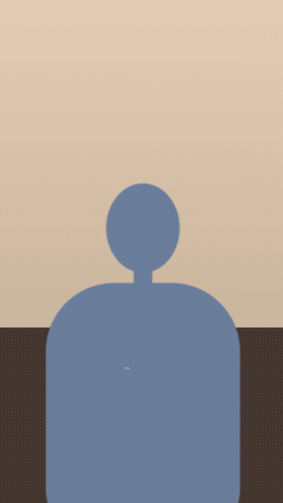

# Captions

Previews use a placeholder figure, not real footage.

```bash
python captions/apply.py --video raw.mp4 --segs segs.json --style karaoke --keywords consultant -o out.mp4
```

| Style | What it does | Preview |
|---|---|---|
| `keyword_red` | 3–4 word chunks on your chest, keywords in red (Poppins) |  |
| `word_pop` | One big word at a time, pops in |  |
| `karaoke` | Full line, the spoken word sits on a red pill (Inter Black) |  |
| `boxed` | Dark text on a white rounded box |  |
| `handwritten` | Marker-style handwriting with a slight tilt (Caveat) |  |
