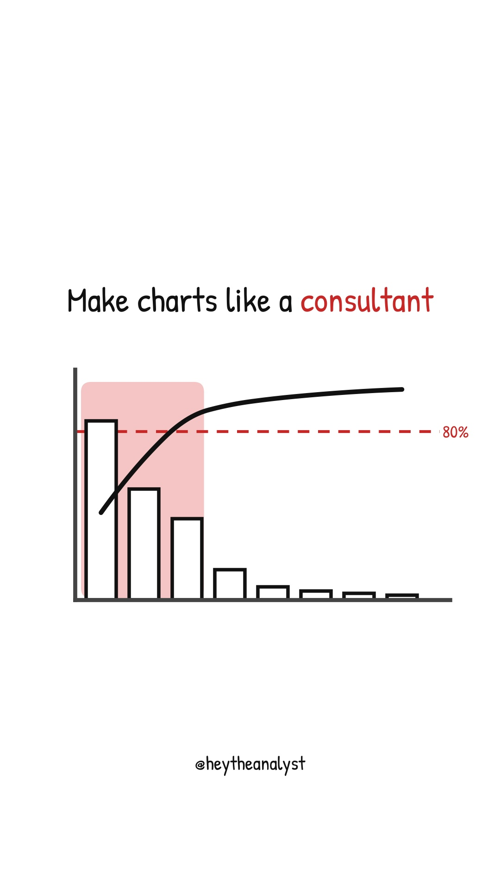
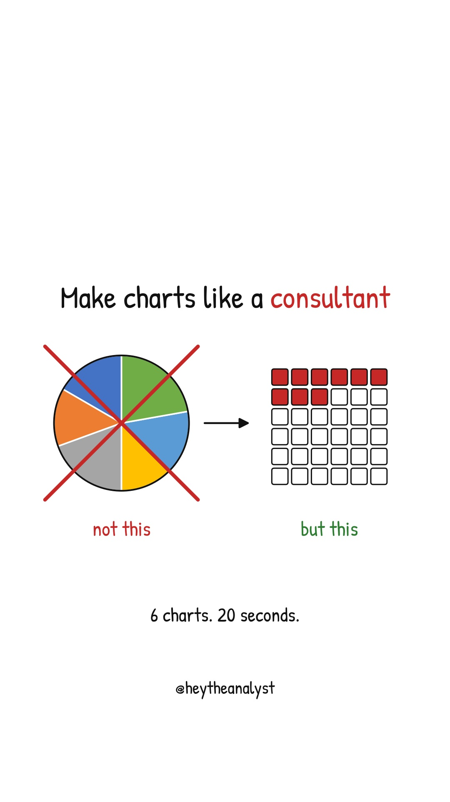
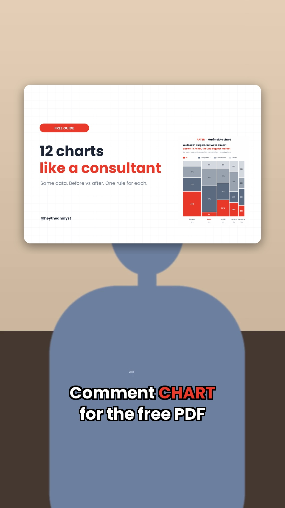
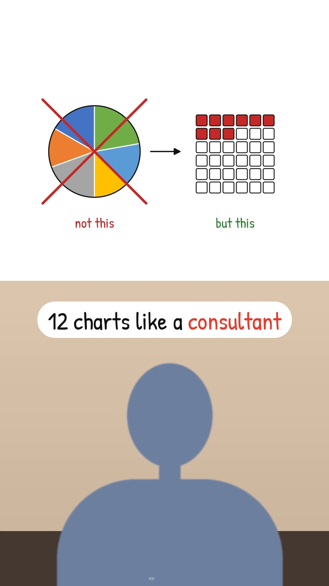

# Covers

Previews use a placeholder figure, not real footage.

```bash
python covers/make.py big_text --video raw.mp4 --time 1 --line1 "12 charts" --line2 "like a consultant" --highlight consultant -o cover.jpg
```

| Style | What it does | Preview |
|---|---|---|
| `handdrawn_pareto` | Hand-drawn chart cover (covers/handdrawn_pareto.py) |  |
| `handdrawn_pie_waffle` | Hand-drawn 'not this / but this' cover (covers/handdrawn_pie_waffle.py) |  |
| `big_text` | Frame of you + dark fade + huge title |  |
| `card_over_face` | Image card above your head + caption on your chest |  |
| `drawing_plus_face` | Drawing on top, you below, title pill above your head |  |
