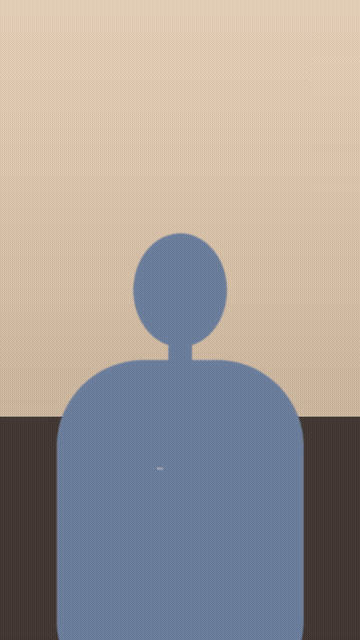

# Layouts

Previews use a placeholder figure, not real footage.

```bash
python -m reelkit.apply layouts phone_mockup --video raw.mp4 --params '{"start": 2, "end": 6, "image": "assets/charts/9b_after.png"}' -o out.mp4
```

| Style | What it does | Preview |
|---|---|---|
| `phone_mockup` | A phone slides up holding a screenshot or chart |  |
