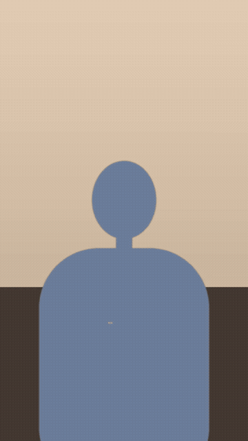
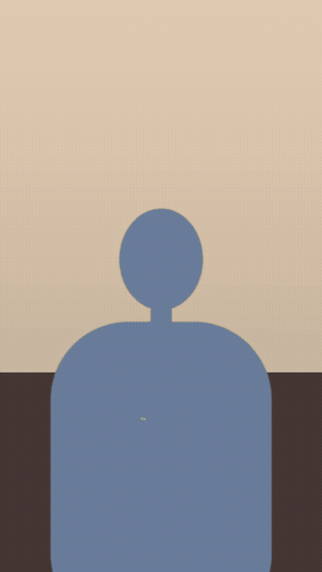
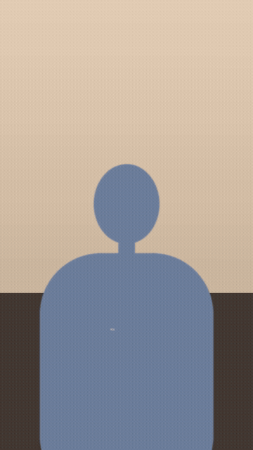
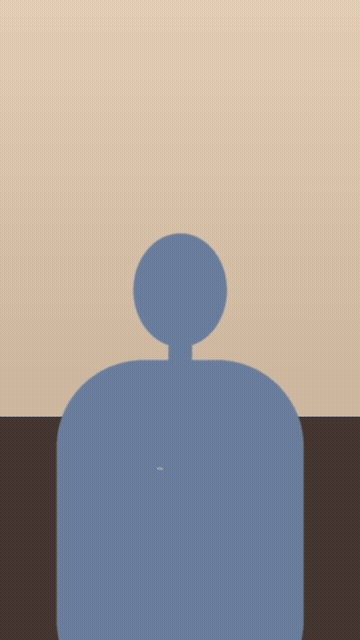

# Looks

Previews use a placeholder figure, not real footage. Styles marked * need a person cut-out (`pip install rembg`).

```bash
python -m reelkit.apply looks letter_dive --video raw.mp4 --params '{"start": 0, "end": 3, "word": "DATA", "letter": 1}' -o out.mp4
```

| Style | What it does | Preview |
|---|---|---|
| `spotlight`* | Room goes dark, you stay lit, a glowing word appears behind you |  |
| `code_body`* | You turn into glowing code over a dark code background |  |
| `letter_dive` | A giant word, your video shows through the letters, then the camera dives into one letter |  |
| `layer_explode`* | The frame splits into 3D layers (room, you, text, sound) with wireframe edges, then snaps back |  |
