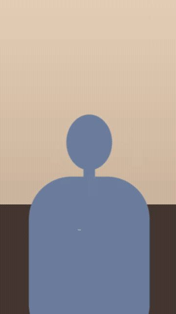
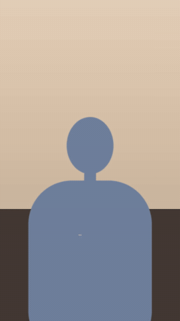
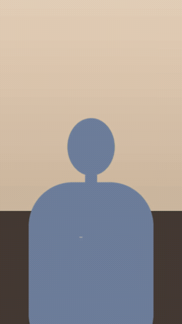
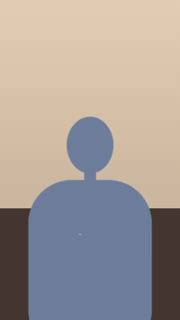

# Overlays

Previews use a placeholder figure, not real footage.

```bash
python -m reelkit.apply overlays head_stack --video raw.mp4 --params '{"start": 1, "end": 5, "labels": ["Pareto", "MECE", "SCR"]}' -o out.mp4
```

| Style | What it does | Preview |
|---|---|---|
| `orbit` | Cards circle your head, behind at the top, in front at the bottom (see `orbit/`) |  |
| `head_stack` | Label blocks drop and stack on top of your head (follows your head) |  |
| `post_wall` | A wall of squares fills in behind you while a counter ticks up |  |
| `live_cursor` | A cursor glides, clicks with a ripple, can drag a blue selection box |  |
