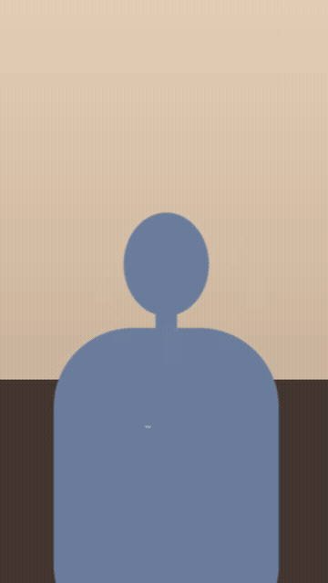

# Orbit

Image cards circle your head: behind you at the top, in front of you at the bottom.

```bash
python overlays/orbit/orbit.py --video raw.mp4 --start 3 --end 6 --images "assets/charts/*b_after.png" -o out.mp4
```
Needs `pip install rembg` for the person cut-out. Tune `--center` and `--radius` so the front of the ring passes below your chin.


